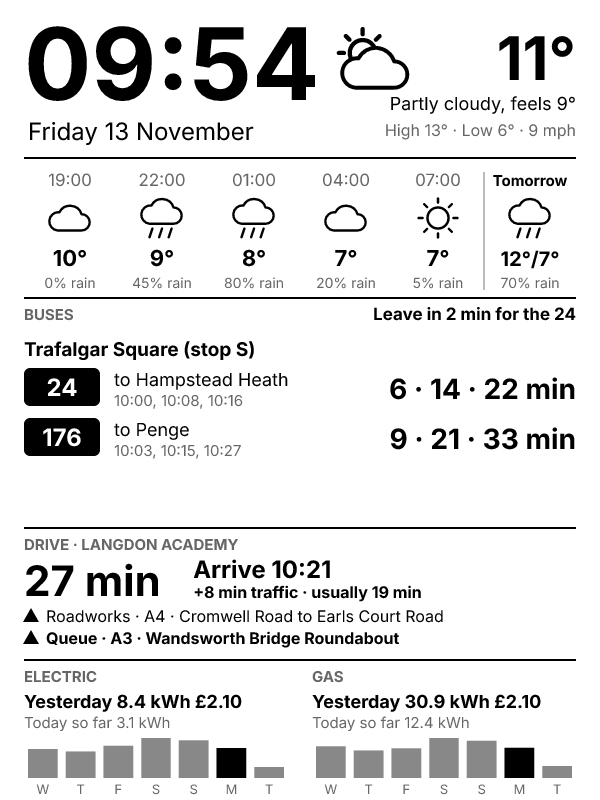

# Kindle dashboard

Turns an old e-ink Kindle into a wall dashboard showing:

- the current time and date
- weather now, the next 12 hours, and tomorrow, plus a rain alert: when the next rain starts (even a little), how heavy, for how long, and the chance of it
- live TfL bus times for your stops, and when to leave for whichever bus you need to set off for first
- drive time and arrival time with live traffic for journeys at set times, a small route map, and roadworks and incidents on the route
- gas and electricity use from your smart meter (yesterday, today so far, and the last 7 days)
- a notice board: notes you add from your phone or by email, on the energy page and the screensaver

Made for the basic Kindle (8th generation, 6", 600 × 800), upright or on its side (`ORIENTATION`). It works in two parts:

1. **A small web service on Vercel (free)** gathers the data and draws it as a grey-scale picture.
   Your keys and passwords stay in Vercel's settings, never on the Kindle or in this repo.
2. **The Kindle** (jailbroken, running [kindle-dash](https://github.com/pascalw/kindle-dash)) downloads
   that picture every minute and shows it.

Any section you don't set up is left out, and the buses get the space.

---

## Part 1: Get your keys and settings ready

| Setting | What it is | How to get it |
|---|---|---|
| `DASH_TOKEN` | A password for your dashboard's address, so only your Kindle can see it. **Required.** | Make up a long random one, e.g. 20+ letters and numbers. |
| `HOME_LATLON` | Where to get the weather for, as `latitude,longitude` | In Google Maps, press and hold on your home; the numbers at the top are it. E.g. `51.54,0.13` |
| `WEATHER_PLACE` | Optional. A name shown with the weather, so it's clear where it's for. | e.g. `Dagenham` |
| `BUS_STOPS` | Your stops, separated by `;`. Add `:` and routes to show only those routes, and `@` and your walk to the stop in minutes. | Find the stop on tfl.gov.uk; its ID is in the page address, e.g. `tfl.gov.uk/bus/stop/490000077E/...` (or send the 5-digit code on the stop sign). Example: `490008458N:62@7; 490008457N:368@10`. To show a stop only at certain times, add days and hours after the walk time: `490008457S:368@12 Sat-Sun 08:00-10:00`. |
| `BUS_HOURS` | Optional. When bus times are shown, as `days times`. Outside these hours the main page shows the smart meter instead (with the drive, if one is due). Not set: always. | e.g. `Mon-Fri 04:30-10:00` |
| `BUS_WALK_MINUTES` | Optional. Walk time for stops without `@`. | e.g. `4` |
| `TOMTOM_KEY` | Drive time and traffic. Free: 2,500 lookups a day. Each update in a journey's time window uses 2 (so a 90-minute window updated every minute uses about 180). | Sign up at developer.tomtom.com, then copy the key from your dashboard there. |
| `DRIVE_FROM` | Where your drives start | A UK postcode, e.g. `E6 2PS`, or `latitude,longitude` |
| `DRIVE_1`, `DRIVE_2`, … | Each journey and when to show it: `days times \| name \| destination`. It shows (and uses TomTom) only during those times. | e.g. `Mon-Fri 06:00-07:30 \| Langdon Academy \| E6 2PS` and `Sat-Sun 18:00-20:00 \| Asda Beckton \| E6 5JP`. Days can also be `Weekdays`, `Weekends`, `Daily` or `Sat,Sun`. To follow your own route instead of the fastest, add `\| via latitude,longitude` parts for points in the middle of roads you take, in order (avoid dual carriageways, where a point can land on the wrong side). |
| `DRIVE_FROM_LABEL` | Optional. The name of where drives start, shown in the heading ("HOME → LANGDON ACADEMY"). Default `Home`. | e.g. `Home` |
| `DRIVE_TO`, `DRIVE_LABEL` | Optional: one journey shown all day instead | Postcode or `latitude,longitude`, and a name |
| `DRIVE_MAP` | Optional. A small map of the route is shown beside the drive time; set `off` to hide it and give the buses more room. | `off` |
| `SCREENSAVER` | Optional. When the Kindle shows the big-clock screensaver; a tap wakes the dashboard for 5 minutes. Default `00:00-06:00`. `outside-drives` shows it at all times except during your `DRIVE_1`, `DRIVE_2`… windows and bus hours (`BUS_HOURS` and any stop's own hours). | e.g. `22:30-06:00`, `outside-drives`, or `off` |
| `NIGHT` | Optional. Night mode hours, to save battery: the Kindle turns Wi-Fi off and only the clock keeps going (it draws it itself), with the overnight rain and tomorrow's weather. A tap wakes the dashboard for 5 minutes. Needs the latest `bus-dash.sh` on the Kindle. | e.g. `22:00-04:00` |
| `ORIENTATION` | Optional. `portrait` (the default), `landscape-right` (Kindle on its side, charging port on the right) or `landscape-left` (port on the left). Landscape puts the clock and weather in a column on the left. | e.g. `landscape-right` |
| `GLOW_USERNAME`, `GLOW_PASSWORD` | Your smart meter, via the free **Bright** app (works with any UK supplier) | Install Bright (by Hildebrand), sign up and link your meter. Use that email and password. |
| `METOFFICE_KEY` | Optional (Secret). Makes the Met Office the first weather source, with Open-Meteo and then yr.no as backups. Free: Weather DataHub, "Site-specific – Global Spot" plan (360 calls a day; this uses about 96). | datahub.metoffice.gov.uk → register → subscribe to Global Spot → copy the API key |
| `KV_REST_API_URL`, `KV_REST_API_TOKEN` | Optional. Storage for the notice board. Set automatically when you connect an Upstash for Redis database (see "Notice board" below). | |
| `NOTES_FROM` | Optional. The email addresses allowed to add notes by email, separated by commas. Others are ignored. | e.g. `me@gmail.com, partner@gmail.com` |
| `NOTES_EMAIL_DAYS` | Optional. How many days an emailed note shows for. Default 7. | e.g. `3` |
| `TFL_APP_KEY` | Optional. Only needed if TfL starts refusing requests. | api-portal.tfl.gov.uk |
| `TIMEZONE` | Optional. Defaults to `Europe/London`. | |

About the smart meter: Bright gets readings from the national smart meter network, usually a day
behind, so "Yesterday" is the reliable figure and "Today so far" may say "no data yet".
The first data can take a day or two to appear after you sign up for Bright.

## Part 2: Put the service on Vercel (free)

1. Merge this code into your `main` branch on GitHub.
2. Go to vercel.com and sign up with your GitHub account.
3. **Add New → Project**, and import `bus-watch`.
4. Set **Root Directory** to `kindle`. Leave Framework Preset as **Other**.
5. Under **Environment Variables**, add the settings from Part 1.
6. Click **Deploy**.
7. Check it: open `https://YOUR-PROJECT.vercel.app/dashboard.png?key=YOUR_DASH_TOKEN` in your phone's browser.
   You should see the dashboard picture. If a section says "unavailable", the message says why
   (for example a wrong key).

If you change a setting later, go to the project's **Deployments** page on Vercel and choose **Redeploy**.

## Part 3: Set up the Kindle

These steps follow the jailbreak guides on kindlemodding.org, which are kept up to date. If anything
there differs from this summary, follow the website.

**Before anything else: turn on Airplane mode on the Kindle.** That stops it from updating itself,
because an update can block the jailbreak.

1. **Check your firmware:** Settings → Device Options → Device Info. The **WinterBreak** jailbreak
   works on firmware before 5.18.1 (e.g. 5.16.2.1.1). For other versions, use "Find my Jailbreak" on
   kindlemodding.org.
2. **Fill the storage** so it can't download an update during the jailbreak: follow
   kindlemodding.org → Jailbreaking → *Prevent Automatic Updates* (it uses a filler script, leaving
   50 to 90 MB free).
3. **Jailbreak with WinterBreak:** kindlemodding.org → Jailbreaking → *WinterBreak*. You copy its files
   to the Kindle, then open the Kindle Store, which starts it. The Kindle needs to be registered to an
   Amazon account. Updates are blocked automatically afterwards, and you can then delete the filler files.
4. **Download kindle-dash:** get the latest release `.tgz` from github.com/pascalw/kindle-dash/releases
   and extract it on your computer (7-Zip can open `.tgz` files).
5. **Add the bus-watch files:** copy `on-kindle/dashboard/bus-dash.sh` from this repo into the extracted
   folder, and the two files from `on-kindle/local/` over the ones in its `local/` folder. Then edit
   `local/fetch-dashboard.sh` and put in your Vercel address and `DASH_TOKEN`.
6. **Copy it over:** plug the Kindle into your computer by USB. Copy the folder to the Kindle's drive and
   name it `dashboard` (so the script is at `dashboard/bus-dash.sh`). Then copy
   `on-kindle/documents/Bus Dashboard.sh` from this repo into the Kindle's `documents` folder.
7. Eject the Kindle, turn Airplane mode off and connect to Wi‑Fi. **Plug it into a USB charger.**
8. In your library, tap **Bus Dashboard**. After about 10 to 20 seconds your dashboard appears.

**How it runs:** the **Bus Dashboard** "book" is a scriptlet, a small script the jailbreak lets you run
from the library. (KUAL, the older app menu, doesn't work with current jailbreaks.) It switches off the
Kindle's own screen and starts `bus-dash.sh`, which:

- downloads **page 1** (clock, weather, buses, drive) and **page 2** (clock, weather, gas and electric)
  at the start of every minute, so the clock stays right;
- swaps between them **every 10 seconds** (only page 1 shows until the smart meter is set up);
- goes back to **page 1 for 5 minutes** when you **tap anywhere** on the screen;
- shows a **screensaver** (big clock and a little weather) during screensaver hours, midnight to
  06:00 unless you set `SCREENSAVER` in Vercel (e.g. `22:30-06:00`, or `off`). A tap or swipe wakes the
  bus page for 5 minutes;
- does a full (flashing) refresh now and then to clear e-ink ghosting;
- in night mode (`NIGHT`, e.g. `22:00-04:00`), turns Wi-Fi off and stops downloading: it fetches a
  background and the clock's digits just before, and changes the digits itself each minute. A tap
  turns Wi-Fi on and wakes the dashboard for 5 minutes;
- reconnects Wi-Fi if it drops (nothing else does while the Kindle's own software is off), and if
  there's been no connection for 3 minutes, shows "No connection since HH:MM, retrying" at the top so
  out-of-date bus times aren't trusted.

These timings are in `local/env.sh`. kindle-dash is still needed for its download tool (`xh`); its own
update loop isn't used. The Kindle stays awake the whole time, so **keep it plugged in**.

**To get the normal Kindle back:** restart it (hold the power button for about 40 seconds).

**If the screen doesn't change, or taps don't switch pages:** look at `dashboard/logs/bus-dash.log` on
the Kindle's drive (connect it by USB). It lists the input devices it found and which one it watches
for taps. If it picked the wrong one, set `TOUCH_DEVICE` in `local/env.sh`.

## Notice board

Short notes shown on the energy page (under the figures, or in place of the hourly forecast when
upright) and at the bottom of the screensaver, newest first.

**Set up the storage (free):** in Vercel, open the project → **Storage** → **Create Database** →
**Upstash for Redis** (free plan) → create it and **Connect** it to this project. That adds
`KV_REST_API_URL` and `KV_REST_API_TOKEN`. Then redeploy.

**Add notes from your phone:** open `https://YOUR-PROJECT.vercel.app/notes?key=YOUR_DASH_TOKEN` and add
it to your home screen. Type a note, choose how long it shows (today, until tomorrow night, a week, a
month, or until removed) and tap **Add**. Tap ✕ to remove one.

**Add notes by email (optional):** sign up at postmarkapp.com (free plan, 100 emails a month), create a
server, and open its **Default Inbound Stream** → Settings. Set the **Webhook URL** to
`https://YOUR-PROJECT.vercel.app/notes?key=YOUR_DASH_TOKEN&email=1` and copy the inbound address it shows
(like `abc123@inbound.postmarkapp.com`). Set `NOTES_FROM` in Vercel to your own email address(es) so
nobody else can post. Then email that address: the subject is the note, plus the first line of the
message if there is one. Emailed notes show for 7 days (`NOTES_EMAIL_DAYS`).

## Changing the dashboard

- **Preview with made-up data:** `npm install`, then `npm run demo`. This writes `preview.png`
  (add `-- --page 2 --notes` for the energy page with some notes).
- **Preview with your real data:** put your settings in a `.env` file in this folder
  (`NAME=value`, one per line; it's ignored by git), then `npm run preview`.
- **Watch it live on a phone or computer:** `https://YOUR-PROJECT.vercel.app/view?key=YOUR_DASH_TOKEN`
  works like the Kindle: new pictures every minute, pages swap every 10 seconds, and a click goes back to page 1.
- **Just the picture:** `https://YOUR-PROJECT.vercel.app/dashboard.png?key=YOUR_DASH_TOKEN&page=1` (or `page=2`).
  Without `&page`, energy goes at the bottom of a single page, as before.
- The layout is in `src/render.js`; each data source has its own file in `src/`.

Data: TfL Open Data, the Met Office (if `METOFFICE_KEY` is set), Open-Meteo and yr.no / MET Norway (CC BY 4.0) as backups, TomTom, Bright (Glowmarkt) and Upstash (notes). Font: Inter (SIL Open Font Licence, `fonts/OFL.txt`).
