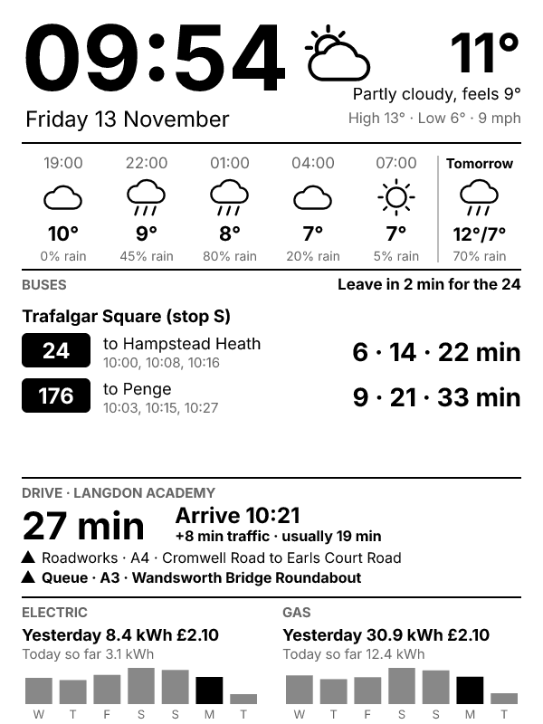

# Kindle dashboard

Turns an old e-ink Kindle into a wall dashboard showing:

- the current time and date
- weather now, the next 12 hours, and tomorrow
- live TfL bus times for your stops, with "leave in N min"
- drive time with live traffic for one journey, plus roadworks and incidents on the route
- gas and electricity use from your smart meter (yesterday, today so far, and the last 7 days)

Made for the basic Kindle (8th generation, 6", 600 × 800). It works in two parts:

1. **A small web service on Vercel (free)** gathers the data and draws it as a grey-scale picture.
   Your keys and passwords stay in Vercel's settings, never on the Kindle or in this repo.
2. **The Kindle** (jailbroken, running [kindle-dash](https://github.com/pascalw/kindle-dash)) downloads
   that picture every 2 minutes and shows it.

Any section you don't set up is left out, and the buses get the space.

---

## Part 1: Get your keys and settings ready

| Setting | What it is | How to get it |
|---|---|---|
| `DASH_TOKEN` | A password for your dashboard's address, so only your Kindle can see it. **Required.** | Make up a long random one, e.g. 20+ letters and numbers. |
| `HOME_LATLON` | Where to get the weather for, as `latitude,longitude` | In Google Maps, press and hold on your home; the numbers at the top are it. E.g. `51.54,0.13` |
| `BUS_STOPS` | Your stops, separated by `;`. Add `:` and routes to show only those routes. | Find the stop on tfl.gov.uk; its ID is in the page address, e.g. `tfl.gov.uk/bus/stop/490000077E/...`. Example: `490000077E:5,145; 490005183E` |
| `BUS_WALK_MINUTES` | Optional. How long it takes you to walk to the stop. Shows "Leave in N min". | e.g. `4` |
| `TOMTOM_KEY` | Drive time and traffic. Free: 2,500 lookups a day. Each update in a journey's time window uses 2. | Sign up at developer.tomtom.com, then copy the key from your dashboard there. |
| `DRIVE_FROM` | Where your drives start | A UK postcode, e.g. `E6 2PS`, or `latitude,longitude` |
| `DRIVE_1`, `DRIVE_2`, … | Each journey and when to show it: `days times \| name \| destination`. It shows (and uses TomTom) only during those times. | e.g. `Mon-Fri 06:00-07:30 \| Langdon Academy \| E6 2PS` and `Sat-Sun 18:00-20:00 \| Asda Beckton \| E6 5JP`. Days can also be `Weekdays`, `Weekends`, `Daily` or `Sat,Sun`. To follow your own route instead of the fastest, add `\| via latitude,longitude` parts for points in the middle of roads you take, in order (avoid dual carriageways, where a point can land on the wrong side). |
| `DRIVE_TO`, `DRIVE_LABEL` | Optional: one journey shown all day instead | Postcode or `latitude,longitude`, and a name |
| `GLOW_USERNAME`, `GLOW_PASSWORD` | Your smart meter, via the free **Bright** app (works with any UK supplier) | Install Bright (by Hildebrand), sign up and link your meter. Use that email and password. |
| `TFL_APP_KEY` | Optional. Only needed if TfL starts refusing requests. | api-portal.tfl.gov.uk |
| `TIMEZONE` | Optional. Defaults to `Europe/London`. | |

About the smart meter: Bright gets readings from the national smart meter network, usually a day
behind, so "Yesterday" is the reliable figure and "Today so far" may say "no data yet".
The first data can take a day or two to appear after you sign up for Bright.

## Part 2: Put the service on Vercel (free)

1. Merge this code into your `main` branch on GitHub.
2. Go to vercel.com and sign up with your GitHub account.
3. **Add New → Project**, and import `bus-watch`.
4. Set **Root Directory** to `kindle`. Leave Framework Preset as **Other**.
5. Under **Environment Variables**, add the settings from Part 1.
6. Click **Deploy**.
7. Check it: open `https://YOUR-PROJECT.vercel.app/dashboard.png?key=YOUR_DASH_TOKEN` in your phone's browser.
   You should see the dashboard picture. If a section says "unavailable", the message says why
   (for example a wrong key).

If you change a setting later, go to the project's **Deployments** page on Vercel and choose **Redeploy**.

## Part 3: Set up the Kindle

These steps follow the jailbreak guides on kindlemodding.org, which are kept up to date. If anything
there differs from this summary, follow the website.

**Before anything else: turn on Airplane mode on the Kindle.** That stops it from updating itself,
because an update can block the jailbreak.

1. **Check your firmware:** Settings → Device Options → Device Info. The **WinterBreak** jailbreak
   works on firmware before 5.18.1 (e.g. 5.16.2.1.1). For other versions, use "Find my Jailbreak" on
   kindlemodding.org.
2. **Fill the storage** so it can't download an update during the jailbreak: follow
   kindlemodding.org → Jailbreaking → *Prevent Automatic Updates* (it uses a filler script, leaving
   50 to 90 MB free).
3. **Jailbreak with WinterBreak:** kindlemodding.org → Jailbreaking → *WinterBreak*. You copy its files
   to the Kindle, then open the Kindle Store, which starts it. The Kindle needs to be registered to an
   Amazon account. Updates are blocked automatically afterwards, and you can then delete the filler files.
4. **Download kindle-dash:** get the latest release `.tgz` from github.com/pascalw/kindle-dash/releases
   and extract it on your computer (7-Zip can open `.tgz` files).
5. **Add your settings:** copy the two files from `on-kindle/local/` in this repo over the ones in the
   extracted `local/` folder. Then edit `local/fetch-dashboard.sh` and put in your Vercel address and `DASH_TOKEN`.
6. **Copy it over:** plug the Kindle into your computer by USB. Copy the extracted kindle-dash folder to
   the Kindle's drive and name it `dashboard` (so `dash.sh` is at `dashboard/dash.sh`). Then copy
   `on-kindle/documents/Bus Dashboard.sh` from this repo into the Kindle's `documents` folder.
7. Eject the Kindle, turn Airplane mode off and connect to Wi‑Fi. **Plug it into a USB charger.**
8. In your library, tap **Bus Dashboard**. After about 10 to 20 seconds your dashboard appears.

The **Bus Dashboard** "book" is a scriptlet: a small script the jailbreak lets you run from the
library. (KUAL, the older app menu, doesn't work with current jailbreaks.) It also switches kindle-dash
to plugged-in mode, where the Kindle stays awake between updates instead of going into deep sleep.
kindle-dash's wake-up timer was made for the Kindle 4 and may not wake newer models, so **keep it
plugged in**. Updating every 2 minutes would use up the battery in about a day either way.

**To get the normal Kindle back:** restart it (hold the power button for about 40 seconds).

**If the screen doesn't change:** look at `dashboard/logs/dash.log` on the Kindle's drive (connect it
by USB). It shows each update and any error.

## Changing the dashboard

- **Preview with made-up data:** `npm install`, then `npm run demo`. This writes `preview.png`.
- **Preview with your real data:** put your settings in a `.env` file in this folder
  (`NAME=value`, one per line; it's ignored by git), then `npm run preview`.
- **Watch it live on a phone or computer:** `https://YOUR-PROJECT.vercel.app/view?key=YOUR_DASH_TOKEN`
  refreshes itself just after every minute.
- **Just the picture:** `https://YOUR-PROJECT.vercel.app/dashboard.svg?key=YOUR_DASH_TOKEN`
- The layout is in `src/render.js`; each data source has its own file in `src/`.

Data: TfL Open Data, Open-Meteo, TomTom and Bright (Glowmarkt). Font: Inter (SIL Open Font Licence, `fonts/OFL.txt`).
